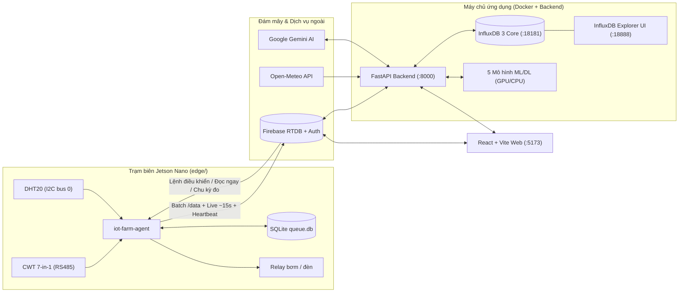

# 🌱 IoT Farm v2 — Hệ Thống Giám Sát, Dự Báo & Điều Khiển Nông Nghiệp Thông Minh

> **Dự án IoT & Xử lý Dữ liệu Nông Nghiệp Thông Minh** — Trường Đại học Công nghệ Thông tin, ĐHQG-HCM (UIT)  
> Hệ thống khép kín từ trạm biên **Jetson Nano** đọc cảm biến đất **CWT 7-in-1 (RS485)** & không khí **DHT20 (I2C)**, đồng bộ hai chiều giữa **Firebase Realtime Database** và **InfluxDB 3 Core**, dự báo đa chân trời bằng **5 mô hình Học máy / Học sâu**, tích hợp khí tượng **Open-Meteo** và trợ lý nông học **Google Gemini AI**.

---

## 📌 Mục lục
1. [Giới thiệu & Kiến trúc hệ thống](#-giới-thiệu--kiến-trúc-hệ-thống)
2. [Thông tin tài khoản đăng nhập](#-thông-tin-tài-khoản-đăng-nhập)
3. [Yêu cầu môi trường & Cổng dịch vụ](#-yêu-cầu-môi-trường--cổng-dịch-vụ)
4. [Cấu hình API Key & Xác thực](#-cấu-hình-api-key--xác-thực)
5. [Hướng dẫn cài đặt & Khởi chạy Fullstack](#-hướng-dẫn-cài-đặt--khởi-chạy-fullstack)
6. [Triển khai trên Jetson Nano & Chạy giả lập](#-triển-khai-trên-jetson-nano--chạy-giả-lập)
7. [Các tính năng chính & Mô hình dự báo](#-các-tính-năng-chính--mô-hình-dự-báo)
8. [Công nghệ sử dụng](#-công-nghệ-sử-dụng)
9. [Cấu trúc thư mục Monorepo](#-cấu-trúc-thư-mục-monorepo)
10. [Tài liệu chuyên sâu & Thông tin đơn vị](#-tài-liệu-chuyên-sâu--thông-tin-đơn-vị)

---

## 📖 Giới thiệu & Kiến trúc hệ thống

**IoT Farm v2** là nền tảng giám sát, phân tích chuỗi thời gian và điều khiển tưới tiêu thông minh cho vườn ớt tại TP. Thủ Đức (`10.8433°N, 106.8389°E`), kết hợp chặt chẽ giữa xử lý tại biên (Edge Computing), đám mây thời gian thực và cơ sở dữ liệu chuỗi thời gian chuyên dụng:

- **Quan trắc 9 chỉ số thực tế:**
  - **Cảm biến đất CWT 7-in-1 (Modbus RTU / RS485):** Độ ẩm đất (`moisture`), Nhiệt độ đất (`soil_temp`), Độ dẫn điện (`ec`), Độ `pH`, Đạm (`N`), Lân (`P`), Kali (`K`).
  - **Cảm biến không khí DHT20 (I2C):** Nhiệt độ không khí (`air_temp`), Độ ẩm không khí (`air_humidity`).
- **Hoạt động bền bỉ khi mất mạng & không có pin RTC:** Trạm biên **Jetson Nano** lưu mẫu vào hàng đợi **SQLite** trước khi gửi, kiểm tra đồng bộ giờ qua `timedatectl` + **SNTP** và dùng đồng hồ đơn điệu (`monotonic`) để hiệu chỉnh ngược mốc thời gian cho các bản ghi đo lúc mới cấp nguồn.
- **Lưu trữ kép & đối chiếu tự động:** Đồng bộ hai chiều giữa **Firebase Realtime Database** (phục vụ realtime UI) và **InfluxDB 3 Core** chạy trong Docker (phục vụ truy vấn SQL chuỗi thời gian tốc độ cao và huấn luyện mô hình).
- **Dự báo & Khuyến nghị thông minh:** Huấn luyện và so sánh **5 mô hình dự báo** (XGBoost, LSTM, N-HiTS, PatchTST, Chronos-Bolt) trên 12 chân trời từ `5 phút` đến `5 ngày`, kết hợp dữ liệu thời tiết **Open-Meteo** (`ET0` FAO-56, lượng mưa) và **Google Gemini AI** / chuẩn dinh dưỡng **Haifa Group**.



---

## 🔐 Thông tin tài khoản đăng nhập

Giao diện Web sử dụng **Firebase Authentication** để bảo vệ các trang giám sát và điều khiển:

| Loại tài khoản | Email | Mật khẩu | Quyền hạn |
| :--- | :--- | :--- | :--- |
| **Quản trị viên (Admin)** | `admin@smartfarm.com` | `admin123456` | Toàn quyền giám sát, dự báo & điều khiển hệ thống |
| **Tài khoản tác giả** | `truonghoangduy.work@gmail.com` | `admin123456` | Toàn quyền giám sát, dự báo & điều khiển hệ thống |

> [!TIP]
> Sau khi đăng nhập, bạn có thể vào mục **Cài đặt** (`/settings`) → **Bảo mật tài khoản** → **Đổi mật khẩu** (`/change-password`) để cập nhật mật khẩu mới.

---

## 💻 Yêu cầu môi trường & Cổng dịch vụ

### 1. Phần mềm cần cài đặt (máy chạy Web & Backend)
- **Node.js**: `>= 18` (khuyến nghị Node.js v20 LTS trở lên).
- **Python**: `>= 3.10` cho Backend (khuyến nghị **Python 3.12**). Riêng trạm biên `edge/` tương thích ngược từ **Python 3.6+** (JetPack 4.6 / Ubuntu 18.04) tới Python 3.12.
- **Docker Desktop**: Dùng để chạy **InfluxDB 3 Core** và giao diện quản trị **InfluxDB 3 Explorer UI**.
- **GPU NVIDIA (Tùy chọn)**: Nếu máy có GPU NVIDIA hỗ trợ CUDA, quá trình huấn luyện (`npm run train`) và suy luận Deep Learning sẽ tự động chạy trên GPU; nếu không có GPU, hệ thống tự chuyển sang CPU.

### 2. Bảng cổng dịch vụ mặc định

| Dịch vụ | Địa chỉ truy cập | Ghi chú |
| :--- | :--- | :--- |
| **Frontend (React + Vite)** | http://localhost:5173 | Đặt ở cổng `5173` để tránh dải TCP `8009–9008` thường bị Windows Hyper-V giữ chỗ |
| **Backend API (FastAPI)** | http://localhost:8000 | Tài liệu Swagger UI trực quan tại http://localhost:8000/docs |
| **InfluxDB 3 Core API** | http://localhost:18181 | Database mặc định: `iot_farm` (bind `127.0.0.1`) |
| **InfluxDB 3 Explorer UI** | http://localhost:18888 | Giao diện duyệt bảng & truy vấn SQL trực quan (đã gắn sẵn kết nối `iot_farm`) |

---

## 🔑 Cấu hình API Key & Xác thực

Dự án được thiết kế để có thể chạy ngay ở chế độ phát triển với cấu hình tối thiểu, đồng thời hỗ trợ khóa quyền truy cập chặt chẽ khi triển khai thực tế:

| Thành phần | Nơi cấu hình | Bắt buộc? | Cách lấy & Thiết lập |
| :--- | :--- | :--- | :--- |
| **1. Google Gemini AI** | `GEMINI_API_KEY` trong `backend/.env` | Tùy chọn | Lấy miễn phí tại https://aistudio.google.com/app/apikey. Nếu để trống, trang `/recommendations` vẫn hoạt động đầy đủ nhờ bộ suy diễn nông học chuẩn **Haifa Group**. |
| **2. Open-Meteo Weather** | `FARM_LAT`, `FARM_LON` trong `backend/.env` | Không cần key | API khí tượng hoàn toàn miễn phí, mặc định trỏ tới vườn tại TP. Thủ Đức (`10.843323, 106.838889`). |
| **3. Frontend ↔ Firebase** | `frontend/src/config/firebaseConfig.tsx` | Đã có sẵn | Đã gắn sẵn cấu hình Web App của project Firebase `iot-farm-chilli`. |
| **4. Backend ↔ Firebase** | `backend/.env` (`FIREBASE_SERVICE_ACCOUNT`) | Chỉ cần khi khóa Rules | Vào *Firebase Console → Project settings → Service accounts → Generate new private key*, lưu thành `backend/secrets/firebase-service-account.json`. |
| **5. Jetson Nano ↔ Firebase** | `[firebase]` trong `edge/config.ini` | Chỉ cần khi khóa Rules | `db_url` đã điền sẵn. Khi áp dụng `firebase/database.rules.json`: tạo user thiết bị trong *Authentication → Users* (ví dụ `jetson-nano-01@smartfarm.com`), lấy **Web API Key** tại *Project settings → General* rồi điền `api_key`, `email`, `password` vào `edge/config.ini`. |

---

## 🚀 Hướng dẫn cài đặt & Khởi chạy Fullstack

> [!NOTE]
> Trên **Windows PowerShell**, nếu gặp thông báo chặn script `npm.ps1 cannot be loaded because running scripts is disabled`, hãy thay chữ `npm` bằng `npm.cmd` trong các lệnh bên dưới (ví dụ: `npm.cmd run dev`).

### Bước 1: Cài đặt thư viện & Tạo file môi trường

```bash
# 1. Cài đặt thư viện cho Frontend
cd frontend
npm install
cd ..

# 2. Tạo môi trường ảo Python 3.12 và cài đặt thư viện cho Backend
cd backend
python -m venv .venv
# Kích hoạt venv:
#   - Windows (PowerShell/CMD): .venv\Scripts\activate
#   - macOS / Linux:            source .venv/bin/activate
pip install -r requirements.txt

# 3. Tạo file cấu hình môi trường (rồi điền GEMINI_API_KEY nếu có)
cp .env.example .env   # Windows CMD: copy .env.example .env
cd ..
```

### Bước 2: Khởi động InfluxDB 3 + Explorer UI (Docker) & Nạp dữ liệu mẫu

```bash
# Bật cả 2 container: iot-farm-influxdb3 (:18181) và iot-farm-influxdb3-explorer (:18888)
docker compose up -d

# Nạp lịch sử cảm biến ban đầu từ soil_all.json vào InfluxDB (chỉ cần chạy lần đầu)
npm run influx:seed
```

### Bước 3: Khởi chạy đồng thời Backend & Frontend

```bash
# Tại thư mục gốc của dự án:
npm run dev
```

Sau khi khởi chạy thành công:
- Mở giao diện Web tại: **http://localhost:5173**
- Mở tài liệu FastAPI Swagger tại: **http://localhost:8000/docs**
- Mở giao diện quản trị InfluxDB Explorer tại: **http://localhost:18888**

*(Nếu muốn chạy riêng từng phần trên 2 cửa sổ terminal độc lập, dùng `npm run dev:backend` và `npm run dev:frontend`).*

### Bước 4: Huấn luyện lại bộ mô hình dự báo (Tùy chọn)

Kho mã nguồn đã đi kèm sẵn trọng số và kết quả đánh giá của cả 5 mô hình trong `backend/artifacts/`. Khi có thêm dữ liệu mới trong InfluxDB và muốn huấn luyện lại toàn bộ:

```bash
npm run train
```

### Tổng hợp các lệnh tiện ích tại thư mục gốc (`package.json`)

| Lệnh | Mô tả |
| :--- | :--- |
| `npm run dev` | Chạy song song cả Frontend (`:5173`) và Backend FastAPI (`:8000`) |
| `npm run dev:frontend` | Chỉ khởi chạy máy chủ phát triển Frontend (Vite) |
| `npm run dev:backend` | Chỉ khởi chạy Backend FastAPI (tự động ưu tiên Python trong `backend/.venv`) |
| `npm run build:frontend` | Đóng gói bản phân phối tối ưu cho Frontend (`frontend/dist`) |
| `npm run install:frontend` | Cài đặt các gói `node_modules` trong `frontend/` |
| `npm run install:backend` | Cài đặt `backend/requirements.txt` bằng `pip` |
| `npm run influx:up` | Khởi động Docker InfluxDB 3 Core + InfluxDB 3 Explorer UI chạy nền |
| `npm run influx:down` | Dừng các container Docker của InfluxDB |
| `npm run influx:seed` | Nạp dữ liệu lịch sử từ `frontend/public/soil_all.json` vào InfluxDB |
| `npm run train` | Huấn luyện & đánh giá toàn bộ 5 mô hình dự báo + 2 baseline (tự nhận GPU CUDA) |

---

## 🤖 Triển khai trên Jetson Nano & Chạy giả lập

Mã nguồn trong thư mục `edge/` được thiết kế riêng cho **NVIDIA Jetson Nano** (tương thích hoàn toàn với Python 3.6 mặc định của JetPack 4.6, không phụ thuộc các thư viện nặng như `firebase-admin`).

### 1. Sơ đồ đấu dây phần cứng tóm tắt

> [!IMPORTANT]
> Chân GPIO trên Jetson Nano hoạt động ở mức điện áp **3.3 V** — tuyệt đối không cấp tín hiệu 5 V trực tiếp vào GPIO. Bơm nước và đèn chiếu sáng phải dùng nguồn riêng cách ly qua tiếp điểm Relay.

- **Cảm biến đất CWT 7-in-1 (RS485 → USB-RS485 `/dev/ttyUSB0`):** Đấu `A+ ↔ A`, `B- ↔ B`, cấp nguồn DC theo nhãn cảm biến (chung `GND` với mạch chuyển). Mặc định truyền thông Modbus RTU ở **slave ID = 2, 9600 baud, 8N1**.
- **Cảm biến không khí DHT20 (I2C bus 0 — `/dev/i2c-0`):** `VDD` → Chân **1** (3.3 V), `SDA` → Chân vật lý **27**, `SCL` → Chân vật lý **28**, `GND` → Chân **6** hoặc **9**.
- **Module Relay 2 kênh (Tùy chọn khi bật `relay_enabled = true`):** `IN1` (bơm) → Chân BOARD **31**, `IN2` (đèn) → Chân BOARD **33**, `VCC` → 5 V (Chân 2/4), `GND` → `GND`.

### 2. Cài đặt tự động khởi chạy cùng hệ điều hành trên Jetson Nano

```bash
# 1. Sao chép thư mục edge lên Jetson Nano (chạy từ máy tính cá nhân):
scp -r edge <user>@<ip-jetson>:~/iot-farm-edge

# 2. SSH vào Jetson Nano và chạy script cài đặt tự động:
ssh <user>@<ip-jetson>
cd ~/iot-farm-edge
chmod +x install.sh
sudo ./install.sh --no-start --set-timezone

# 3. Kiểm tra / điền thông tin xác thực Firebase (nếu khóa Rules)
nano config.ini

# 4. Đọc thử cảm biến thật 1 lần tại chỗ để xác nhận phần cứng OK
.venv/bin/python run_agent.py --once

# 5. Bật systemd service (tự động chạy nền mỗi lần cắm điện bật máy)
sudo systemctl start iot-farm-agent
journalctl -u iot-farm-agent -f
```

### 3. Cơ chế hoạt động nổi bật của `iot-farm-agent`
- **Lưu trữ Offline trước (`edge/data/queue.db`):** Mọi mẫu định kỳ đều ghi vào SQLite trước, sau đó luồng `uploader` mới đẩy theo lô (`<= 500` bản ghi/lần) lên `/data` khi kiểm tra có mạng (`DNS + TCP`) và đồng hồ đã hợp lệ.
- **Đồng bộ & Hiệu chỉnh giờ không cần RTC:** Kết hợp trạng thái `timedatectl` và gói tin **SNTP** thực tế để xác thực đồng hồ hệ thống; nếu Jetson vừa bật máy khi mất mạng, agent ghi nhận `monotonic_ns` và tự động tính ngược lại mốc giờ thật ngay khi có NTP trở lại (`tq = ntp | corrected | estimated`).
- **Số đọc tức thời (~15 giây) & Nút "Đọc ngay":** Song song với chu kỳ lưu lịch sử (mặc định 5 phút), Jetson đẩy bản chụp cảm biến mới nhất lên `devices/{id}/live` mỗi ~15 giây và lắng nghe lệnh `read_now` từ giao diện Web để đọc phần cứng ngay lập tức mà không làm nhiễu chuỗi dữ liệu lịch sử `/data`.

### 4. Chạy giả lập trạm Jetson ngay trên PC (không cần phần cứng)

```bash
python edge/run_agent.py --simulate --assume-synced --interval 30
```

Chạy bộ kiểm thử tự động cho `edge/` (kiểm tra cú pháp Python 3.6 + 17 bài unit test hàng đợi, hiệu chỉnh thời gian, live snapshot & relay):

```bash
python edge/tests/check_py36.py
python -m unittest discover -s edge/tests -p "test_*.py" -v
```

*(Xem hướng dẫn chi tiết toàn bộ tham số `config.ini` và xử lý sự cố phần cứng tại `edge/README.md`).*

---

## ✨ Các tính năng chính & Mô hình dự báo

### 1. Chín màn hình chức năng trên Giao diện Web

1. **Tổng quan (`/`)**: Hiển thị trực quan 9 chỉ số đất & không khí theo thời gian thực (tự động ưu tiên số đọc Live ~15s khi thiết bị online), thẻ trạng thái phần cứng Jetson Nano (NTP, hàng đợi offline, relay) kèm nút **"Đọc ngay"**, biểu đồ biến động lịch sử và đường dự báo nhanh.
2. **Thông tin cây trồng (`/plant`)**: Quản lý mùa vụ và theo dõi tiến độ từng giai đoạn sinh trưởng của cây ớt (*Ươm mầm → Cây con → Sinh trưởng → Ra hoa → Đậu quả → Thu hoạch*), đối chiếu thông số thực tế với ngưỡng lý tưởng của từng giai đoạn.
3. **Cảnh báo (`/alerts`)**: Tự động phát hiện bất thường cận trên / cận dưới cho cả 9 chỉ số với 3 mức độ nghiêm trọng (`Thấp`, `Trung bình`, `Nguy hiểm`), hỗ trợ lọc theo mức độ và đánh dấu đã xử lý đồng bộ lên Firebase.
4. **Điều khiển tưới tiêu (`/controls`)**: Chuyển đổi linh hoạt giữa 3 chế độ **Thủ công (Manual)**, **Tự động theo ngưỡng ẩm (Auto)** và **Lịch trình (Schedule)**; đồng bộ lệnh bật/tắt bơm và đèn xuống Jetson Nano với cơ chế ngắt an toàn khi vượt thời gian chạy tối đa.
5. **Khuyến nghị nông học (`/recommendations`)**: Phân tích chuyên sâu từ **Google Gemini AI** (`gemini-2.5-flash`) kết hợp bộ quy tắc phân bón **Haifa Group** và cân bằng nước tưới dựa trên lượng bốc thoát hơi tham chiếu **ET0 (FAO-56)** cùng dự báo mưa của Open-Meteo.
6. **Dự báo & So sánh mô hình (`/models`)**: Dự báo toàn bộ 9 chỉ số ở **12 chân trời thời gian** (`5m`, `10m`, `30m`, `1h`, `2h`, `6h`, `12h`, `1d`, `2d`, `3d`, `4d`, `5d`) kèm khoảng bất định **P10–P90**, bảng xếp hạng định lượng (`MAE`, `RMSE`, `sMAPE`, `MASE`, $R^2$) trên tập kiểm tra độc lập và thẻ hồ sơ học thuật cho từng mô hình.
7. **Thời tiết & Tương quan (`/weather`)**: Quan trắc thời tiết hiện tại, dự báo 16 ngày tới và lịch sử tái phân tích **ERA5** từ Open-Meteo; phân tích ma trận tương quan (Pearson / Spearman) và độ trễ (*cross-correlation lag*) giữa mưa, bức xạ, `ET0` với độ ẩm và nhiệt độ đất.
8. **Nhật ký & Đồng bộ DB (`/logs`)**: Theo dõi trạng thái đối chiếu hai chiều giữa **Firebase RTDB** và **InfluxDB 3 Core** theo từng ngày, kích hoạt đồng bộ / backfill thủ công và tra cứu nhật ký hoạt động của hệ thống.
9. **Cài đặt (`/settings`)**: Điều chỉnh từ xa chu kỳ lấy mẫu của Jetson Nano (`5 giây – 24 giờ`), tinh chỉnh ngưỡng cảnh báo cho 9 chỉ số, cập nhật ngày gieo trồng và quản lý bảo mật tài khoản (`/change-password`).

### 2. Các mô hình dự báo chuỗi thời gian được triển khai

Hệ thống đánh giá nghiêm ngặt theo phương pháp chia chuỗi thời gian tuần tự **70% Train / 10% Validation / 20% Test** kết hợp kiểm định cửa sổ trượt (*rolling-origin evaluation*) trên 5 mô hình chính và 2 mô hình đối chứng (*Naive*, *Seasonal Naive* — Hyndman & Athanasopoulos, 2021):

| Mô hình | Họ kiến trúc | Vai trò trong dự án | Công trình gốc & DOI |
| :--- | :--- | :--- | :--- |
| **XGBoost** | Gradient Boosted Decision Trees | Mô hình cây quyết định tăng cường tốc độ cao trên đặc trưng trễ, thống kê trượt, chu kỳ ngày/năm và biến ngoại sinh thời tiết | Chen & Guestrin (KDD 2016) — https://doi.org/10.1145/2939672.2939785 |
| **LSTM** | Recurrent Neural Network | Mạng hồi quy có cổng nhớ nắm bắt động lực học phi tuyến ngắn hạn của nhiệt – ẩm đất | Hochreiter & Schmidhuber (1997) — https://doi.org/10.1162/neco.1997.9.8.1735 |
| **N-HiTS** | Hierarchical Interpolation MLP | Nội suy phân cấp đa tần số chuyên biệt cho dự báo chuỗi thời gian nhiều bước xa | Challu et al. (AAAI 2023) — https://doi.org/10.1609/aaai.v37i6.25854 |
| **PatchTST** | Channel-Independent Transformer | Chia chuỗi thành các bản vá (*patches*) kết hợp cơ chế tự chú ý (*self-attention*) cho phụ thuộc dài hạn | Nie et al. (ICLR 2023) — https://doi.org/10.48550/arXiv.2211.14730 |
| **Chronos-Bolt** | Pretrained Time-Series Foundation Model | Mô hình nền tảng chuỗi thời gian của Amazon suy luận *zero-shot* trực tiếp không cần huấn luyện lại theo từng vườn | Ansari et al. (TMLR 2024) — https://doi.org/10.48550/arXiv.2403.07815 |

---

## 🛠 Công nghệ sử dụng

- **Frontend:** React 18, TypeScript, Vite, Tailwind CSS, shadcn/ui, TanStack React Query, Recharts, Lucide Icons.
- **Backend API:** Python 3.12, FastAPI, Uvicorn, Pydantic v2, HTTPX.
- **Khoa học Dữ liệu & AI/ML:** PyTorch (hỗ trợ CUDA), XGBoost, NeuralForecast (LSTM, N-HiTS, PatchTST), Amazon Chronos-Bolt (`chronos-forecasting`), Scikit-learn, Pandas, SciPy, Google GenAI SDK (`gemini-2.5-flash`).
- **Cơ sở dữ liệu & Đám mây:**
  - **Firebase Realtime Database & Firebase Authentication** (đồng bộ realtime Edge ↔ Web ↔ Backend).
  - **InfluxDB 3 Core** & **InfluxDB 3 Explorer UI** chạy trên Docker (lưu trữ & truy vấn SQL chuỗi thời gian).
  - **Open-Meteo Forecast & ERA5 Archive API** (khí tượng nông nghiệp & `ET0` FAO-56).
- **Trạm biên (Edge IoT):** NVIDIA Jetson Nano, Python 3.6+, PySerial (Modbus RTU RS485), `smbus2` (I2C DHT20), SQLite WAL queue, SNTP client, `systemd`.

---

## 📁 Cấu trúc thư mục Monorepo

```text
Final Project/
├── backend/                        # Máy chủ FastAPI, đồng bộ DB, thời tiết & AI/ML
│   ├── app/
│   │   ├── main.py                 # Điểm khởi tạo FastAPI & các luồng nền
│   │   ├── config.py               # Quản lý biến môi trường (.env)
│   │   ├── ml/                     # Pipeline đặc trưng, huấn luyện, suy luận & thẻ mô hình
│   │   ├── routers/                # Các nhóm endpoint: forecast, weather, sync, advice...
│   │   └── services/               # Client InfluxDB 3, Firebase REST, Open-Meteo, Sync engine
│   ├── artifacts/                  # Trọng số đã huấn luyện & bảng metrics đánh giá mô hình
│   ├── scripts/seed_influx.py      # Script nạp dữ liệu lịch sử ban đầu vào InfluxDB 3
│   ├── .env.example                # Mẫu cấu hình biến môi trường Backend
│   └── requirements.txt            # Danh sách thư viện Python Backend (hỗ trợ PyTorch CUDA)
├── frontend/                       # Giao diện Web (React 18 + TypeScript + Vite, cổng 5173)
│   ├── public/soil_all.json        # Tập dữ liệu lịch sử cảm biến dùng để seed/offline fallback
│   └── src/
│       ├── components/             # Thành phần giao diện (SensorCard, DeviceStatusCard, Charts...)
│       ├── config/firebaseConfig.tsx
│       ├── contexts/AuthContext.tsx
│       ├── hooks/                  # React hooks trạng thái thiết bị, live snapshot, dữ liệu
│       ├── pages/                  # 9 màn hình chính + Login & ChangePassword
│       └── services/               # Giao tiếp Firebase RTDB & Backend REST API
├── edge/                           # Trạm biên chạy trên Jetson Nano (Python 3.6+)
│   ├── farm_agent/                 # Đọc cảm biến, hàng đợi SQLite, SNTP, Firebase REST, Relay
│   ├── systemd/                    # Cấu hình dịch vụ tự chạy nền iot-farm-agent.service
│   ├── tests/                      # Unit test, mock Firebase & kiểm tra tương thích Python 3.6
│   ├── config.example.ini          # Mẫu cấu hình cho Jetson Nano
│   ├── install.sh                  # Script cài đặt tự động trên Jetson Nano
│   └── run_agent.py                # Điểm vào chạy agent hoặc chế độ giả lập
├── docker/explorer-config/         # Cấu hình tự động kết nối cho InfluxDB 3 Explorer UI
├── firebase/database.rules.json    # Quy tắc bảo mật & đánh chỉ mục Firebase Realtime Database
├── docs/                           # Tài liệu thiết kế kiến trúc & cơ sở lý thuyết mô hình
│   ├── SYSTEM_DESIGN.md
│   └── MODELS.md
├── scripts/                        # Script điều phối chạy đa nền tảng cho npm scripts
├── read_soil.py                    # Script gốc đọc thử cảm biến đất CWT 7-in-1 (RS485)
├── read_dht20.py                   # Script gốc đọc thử cảm biến không khí DHT20 (I2C)
├── docker-compose.yml              # Khởi chạy InfluxDB 3 Core (:18181) + Explorer UI (:18888)
└── package.json                    # Quản lý lệnh chạy chung cho toàn Monorepo
```

---

## 📚 Tài liệu chuyên sâu & Thông tin đơn vị

### Tài liệu kỹ thuật đi kèm trong kho mã nguồn
- Thiết kế kiến trúc tổng thể, lược đồ dữ liệu & cơ chế đồng bộ hai chiều: [`docs/SYSTEM_DESIGN.md`](./docs/SYSTEM_DESIGN.md)
- Cơ sở toán học, quy trình tạo đặc trưng, chia tập dữ liệu & đánh giá 5 mô hình dự báo: [`docs/MODELS.md`](./docs/MODELS.md)
- Hướng dẫn đấu nối phần cứng, cấu hình `systemd` & kiểm thử trên Jetson Nano: [`edge/README.md`](./edge/README.md)

### Thông tin đơn vị thực hiện
- **Đơn vị:** Trường Đại học Công nghệ Thông tin — ĐHQG-HCM (UIT)
- **Môn học / Học phần:** Kỹ thuật Xử lý Dữ liệu (`IT2047`) & Hệ thống IoT Nông nghiệp Thông minh
- **Năm thực hiện:** 2025 – 2026
