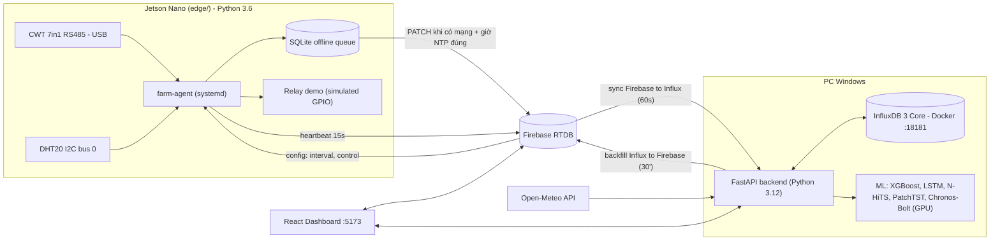

# IoT Farm v2 – Thiết kế hệ thống (System Design & Contract)

> Tài liệu này vừa là **kế hoạch** cho người dùng, vừa là **hợp đồng kỹ thuật** (schema Firebase, InfluxDB, API) mà mọi phần code (Jetson / Backend / Frontend / ML) phải tuân theo.

## 1. Kiến trúc tổng thể



## 2. Cấu trúc thư mục mới

| Thư mục | Nội dung |
|---|---|
| `edge/` | **Code chạy trên Jetson Nano** (tách riêng, Python 3.6, không phụ thuộc backend) |
| `backend/app/services/` | `firebase_client.py`, `influx_service.py`, `sync_service.py`, `weather_service.py` |
| `backend/app/ml/` | Pipeline dự báo: dữ liệu, mô hình, đánh giá, huấn luyện, suy luận |
| `backend/artifacts/` | Mô hình đã huấn luyện + `metrics.json` (gitignore) |
| `docker-compose.yml` | InfluxDB 3 Core |
| `firebase/database.rules.json` | Security Rules đề xuất |

## 3. Firebase Realtime Database – schema

Mọi thời gian dạng key là **giờ địa phương Asia/Ho_Chi_Minh (UTC+7)**. `ts` = epoch giây UTC.

```text
data/{YYYY-MM-DD}/{HH:MM:SS}            # key cũ "HH:MM" vẫn hợp lệ -> frontend phải parse cả 2
    temperature, humidity               # DHT20 (°C, %RH)
    soiltemp, moisture, pH, EC, N, P, K # CWT (°C, %, -, mS/cm, mg/kg)
    ts: int                             # epoch s (UTC)
    tq: "ntp" | "corrected" | "estimated"   # chất lượng mốc thời gian (không có RTC)
devices/{device_id}/status              # device_id mặc định: "jetson-nano-01"
    online: bool, last_seen: {".sv":"timestamp"} (ms, server time), device_time: epoch s
    hostname, ip, fw_version, interval_sec, heartbeat_sec, queue_pending: int
    ntp_synced: bool, clock_offset_ms: number|null, network_ok: bool
    sensors: { soil: "ok"|"error"|"simulated", dht20: "ok"|"error"|"simulated" }
    last_error: string|null, cpu_temp_c, uptime_s, simulate: bool
devices/{device_id}/last_reading        # bản ghi mới nhất (same shape as data record) + key
streaming/config/sampling_interval_sec  # int 5..86400, mặc định 300 (UI Settings ghi, Jetson đọc)
streaming/config/...                    # giữ nguyên: threshold, irrigation_mode, irrigation_time, light_mode, light_time, plant
streaming/config/irrigation_duration_min  # int, mặc định 5 (dùng cho chế độ schedule)
streaming/control/{pump|light}
    status: bool        # trạng thái MONG MUỐN (UI ghi ở chế độ manual)
    actual: bool        # trạng thái THỰC TẾ do Jetson báo lại
    simulated: bool     # true khi chưa có relay thật
    last_on_time: string, daily_time: number (giờ), updated_at: {".sv":"timestamp"}
logs/firebase_writes/{YYYY-MM-DD}/{pushId}   # Jetson ghi sau mỗi lô upload
    ts: {".sv":"timestamp"}, device_id, n_records, first_key, last_key, status: "ok"|"error",
    http_status, duration_ms, queue_pending, from_backlog: bool, error
logs/sync/{YYYY-MM-DD}/{pushId}              # Backend ghi sau mỗi lần đồng bộ
    ts, direction: "firebase_to_influx"|"influx_to_firebase", n_records, range_start, range_end,
    status: "ok"|"error"|"noop", duration_ms, error
recommendations/latest                  # giữ nguyên
```

**Trạng thái Online/Offline**: `online = (serverNow - last_seen) <= max(3 × heartbeat_sec, 30 s)`, với `serverNow = Date.now() + .info/serverTimeOffset`. Heartbeat = `min(interval, 15 s)`.

## 4. InfluxDB 3 Core – schema (database `iot_farm`)

| Table | Tags | Fields |
|---|---|---|
| `sensor_data` | `device_id` | temperature, humidity, soiltemp, moisture, pH, EC, N, P, K (float), `tq` (string) |
| `weather` | `kind` = archive/forecast, `location` | temperature_2m, relative_humidity_2m, precipitation, rain, cloud_cover, shortwave_radiation, et0_fao_evapotranspiration, vapour_pressure_deficit, wind_speed_10m, soil_temperature_0cm, soil_moisture_0_to_1cm, … |
| `sync_log` | `direction`, `status` | n_records, duration_ms, range_start, range_end, error |

Không đặt "source" làm tag để InfluxDB tự khử trùng lặp theo (series, timestamp). Docker chạy `--query-file-limit` cao vì InfluxDB 3 Core mặc định chỉ cho truy vấn ~72 h (432 file Parquet).

## 5. Backend API (prefix `/api`)

| Method | Path | Mô tả |
|---|---|---|
| GET | `/api/sync/status` | Trạng thái đồng bộ, watermark, lần chạy gần nhất |
| GET | `/api/sync/logs?direction=&limit=200` | Log đồng bộ (từ InfluxDB `sync_log`) |
| POST | `/api/sync/run?direction=both` | Chạy đồng bộ ngay |
| GET | `/api/history?start=&end=&every=5m&fields=` | Dữ liệu cảm biến từ InfluxDB (gộp theo bucket) |
| GET | `/api/weather/current` | Thời tiết hiện tại |
| GET | `/api/weather/history?start=YYYY-MM-DD&end=YYYY-MM-DD` | Dữ liệu cũ (ERA5 archive + bù forecast gần đây), hourly |
| GET | `/api/weather/forecast?days=7` | Dự báo hourly tới 16 ngày |
| GET | `/api/weather/correlation?days=30&method=pearson&max_lag_h=24` | Ma trận tương quan thời tiết ↔ cảm biến + độ trễ tối ưu |
| GET | `/api/forecast/models` | Danh sách mô hình, bài báo, DOI, thiết bị train, trạng thái |
| GET | `/api/forecast?target=moisture&horizon=6h&model=best` | Dự báo: history + forecast (yhat, lo, hi) |
| GET | `/api/forecast/metrics?target=&horizon=` | Bảng chỉ số đánh giá |
| POST | `/api/forecast/train` / GET `/api/forecast/train/status` | Huấn luyện nền |

Horizon keys: `5m, 10m, 30m, 1h, 2h, 6h, 12h, 1d, 2d, 3d, 4d, 5d`.
Targets: `temperature, humidity, soiltemp, moisture, pH, EC, N, P, K` (bỏ `light`).

## 6. Mô hình dự báo (5 mô hình + 2 baseline)

| # | Mô hình | Trường phái | Lý do chọn | Tài liệu gốc |
|---|---|---|---|---|
| 1 | **XGBoost** | Gradient Boosting | Rất mạnh trên dữ liệu bảng/đặc trưng trễ; họ GBDT thắng M5 | Chen & Guestrin (2016), KDD. [doi:10.1145/2939672.2939785](https://doi.org/10.1145/2939672.2939785) |
| 2 | **LSTM** | Mạng hồi quy | Chuẩn mực deep learning cho chuỗi thời gian | Hochreiter & Schmidhuber (1997), Neural Computation 9(8). [doi:10.1162/neco.1997.9.8.1735](https://doi.org/10.1162/neco.1997.9.8.1735) |
| 3 | **N-HiTS** | Deep MLP đa tầng tần số | SOTA cho dự báo dài, nhanh hơn Transformer ~50× | Challu et al. (2023), AAAI 37(6). [doi:10.1609/aaai.v37i6.25854](https://doi.org/10.1609/aaai.v37i6.25854) |
| 4 | **PatchTST** | Transformer | SOTA Transformer dự báo dài hạn | Nie et al. (2023), ICLR. [doi:10.48550/arXiv.2211.14730](https://doi.org/10.48550/arXiv.2211.14730) |
| 5 | **Chronos-Bolt** | Foundation model (pretrained) | Pretrain trên ~100 tỷ điểm dữ liệu, dự báo zero-shot | Ansari et al. (2024), TMLR. [doi:10.48550/arXiv.2403.07815](https://doi.org/10.48550/arXiv.2403.07815) |
| – | Naive / Seasonal Naive | Baseline | Mốc so sánh bắt buộc, dùng để tính MASE | Hyndman & Athanasopoulos, *FPP3* |

Tham khảo thêm: Makridakis et al. (2022) M5 accuracy competition, IJF – [doi:10.1016/j.ijforecast.2021.11.013](https://doi.org/10.1016/j.ijforecast.2021.11.013); Taieb et al. (2012) chiến lược dự báo nhiều bước – [doi:10.1016/j.eswa.2012.01.039](https://doi.org/10.1016/j.eswa.2012.01.039).

**GPU**: tự kiểm tra `torch.cuda.is_available()` → dùng `cuda` (RTX 3070) cho LSTM / N-HiTS / PatchTST / Chronos và `device="cuda"` cho XGBoost; không có GPU thì tự chuyển CPU. Thiết bị đã dùng được ghi vào `metrics.json` và hiển thị trên Dashboard.

### Dự báo đa độ phân giải
| Nhóm | Độ phân giải | Horizon | Cửa sổ đầu vào | Biến ngoại sinh |
|---|---|---|---|---|
| Ngắn hạn | 5 phút | 5′, 10′, 30′, 1h, 2h, 6h, 12h (tối đa 144 bước) | 2 ngày (576 bước) | giờ trong ngày |
| Dài hạn | 1 giờ | 1d, 2d, 3d, 4d, 5d (tối đa 120 bước) | 14 ngày (336 bước) | thời tiết Open-Meteo (nhiệt độ, ẩm, mưa, bức xạ, ET0) + giờ |

Dữ liệu được resample về lưới 5 phút (trung bình) bất kể interval lấy mẫu của Jetson (5 s – 24 h).

### Chia dữ liệu train/test – KHÔNG train toàn bộ khi đánh giá
- Chia **theo thời gian, không xáo trộn**: **Train 70% → Validation 10% → Test 20%** (đoạn cuối cùng).
- Validation: early-stopping và chọn siêu tham số. Test: chỉ dùng **1 lần** để báo cáo.
- Đánh giá trên test bằng **rolling-origin** (nhiều thời điểm phát dự báo trượt dọc tập test) – Tashman (2000), IJF, [doi:10.1016/S0169-2070(00)00065-0](https://doi.org/10.1016/S0169-2070(00)00065-0); Bergmeir & Benítez (2012), [doi:10.1016/j.ins.2011.12.028](https://doi.org/10.1016/j.ins.2011.12.028).
- Chuẩn hóa (scaler) chỉ fit trên train → tránh rò rỉ dữ liệu.
- Sau khi có chỉ số, mô hình **được huấn luyện lại trên toàn bộ dữ liệu** để dự báo thực tế (chỉ số báo cáo vẫn là của tập test).

### Chỉ số đánh giá
| Chỉ số | Ý nghĩa |
|---|---|
| MAE | Sai số tuyệt đối trung bình (đúng đơn vị đo) |
| RMSE | Phạt nặng sai số lớn |
| MAPE / sMAPE | Sai số phần trăm (sMAPE ổn định hơn khi giá trị gần 0) |
| **MASE** | MAE chia cho MAE của Seasonal Naive (chu kỳ 1 ngày); < 1 nghĩa là tốt hơn baseline – Hyndman & Koehler (2006), [doi:10.1016/j.ijforecast.2006.03.001](https://doi.org/10.1016/j.ijforecast.2006.03.001) |
| R² | Tỷ lệ phương sai giải thích được |
| Coverage 80% | Tỷ lệ giá trị thật rơi vào khoảng dự báo (mô hình xác suất) |

Tính theo **từng mô hình × từng biến × từng horizon**; mô hình "best" cho mỗi (biến, horizon) = MASE thấp nhất trên test.

## 7. Jetson Nano agent (`edge/`)
- Python 3.6 (JetPack 4.6), thư viện tối thiểu: `requests`, `minimalmodbus`, `pyserial`, `smbus2` (tái sử dụng logic từ `read_soil.py`, `read_dht20.py`; EC đổi µS/cm → mS/cm).
- Khởi động cùng hệ thống bằng **systemd** (`Restart=always`).
- **Trước mỗi lần gửi**: (1) kiểm tra mạng (DNS + TCP 443 tới Firebase), (2) kiểm tra đồng bộ giờ **NTP** (`timedatectl` + truy vấn SNTP). Không có RTC → bản ghi lưu kèm `monotonic` + `boot_id`; khi NTP đồng bộ, mốc thời gian được **hiệu chỉnh ngược** (`tq="corrected"`).
- **Offline**: mọi mẫu ghi vào SQLite trước, sau đó mới upload theo lô (PATCH multi-path, ≤ 500 bản ghi/lô); thất bại thì giữ lại và thử lại với back-off.
- Log: file xoay vòng trên Jetson + `logs/firebase_writes` trên Firebase.
- Đọc `sampling_interval_sec` mỗi 15 s → áp dụng không cần khởi động lại.
- **Relay demo**: chế độ manual/auto/schedule cho bơm & đèn, mặc định `simulated` (chưa có relay); khi có mạch chỉ cần đặt `relay_enabled=true` + số chân GPIO.
- Chế độ `--simulate` để chạy thử toàn bộ luồng trên PC không cần phần cứng.

## 8. Xác thực Firebase (API key)
| Thành phần | Cách xác thực | Cần làm trên Firebase Console |
|---|---|---|
| Frontend | Firebase Auth email/password (đã có) | – |
| Jetson | Firebase Auth email/password **tài khoản thiết bị** qua REST + Web API Key | Tạo user `jetson-nano-01@smartfarm.com` |
| Backend | **Service Account** (Admin, bỏ qua Rules) | Project settings → Service accounts → Generate new private key → `backend/secrets/firebase-service-account.json` |

Sau đó deploy `firebase/database.rules.json` (yêu cầu `auth != null`).

## 9. Kế hoạch kiểm thử
- Edge: chạy `--simulate` trên PC → kiểm tra queue offline (ngắt mạng giả lập), hiệu chỉnh thời gian, upload theo lô.
- Backend: InfluxDB Docker + seed `soil_all.json` → sync 2 chiều, log.
- ML: huấn luyện thật trên dữ liệu 261 ngày bằng GPU, kiểm tra metrics hợp lý (MASE < 1 so với Seasonal Naive).
- Frontend: `npm run build` + kiểm tra các trang.
