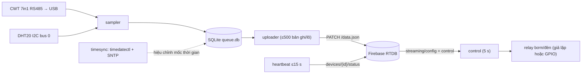

# IoT Farm – Edge agent cho Jetson Nano

Chương trình chạy nền trên **Jetson Nano (JetPack 4.6 / Ubuntu 18.04 / Python 3.6)**:
đọc cảm biến đất **CWT 7in1 (RS485)** và cảm biến không khí **DHT20 (I2C)** → lưu **SQLite trước** →
gửi lên **Firebase Realtime Database** theo lô khi có mạng và giờ đã đúng. Chương trình cũng gửi heartbeat,
nhận cấu hình từ Dashboard và điều khiển relay demo (bơm/đèn).



## 1. Cấu trúc thư mục

| Đường dẫn | Nội dung |
|---|---|
| `run_agent.py` | Điểm vào (`python3 run_agent.py --help`) |
| `farm_agent/config.py` | Đọc `config.ini` (configparser) + tham số dòng lệnh |
| `farm_agent/sensors/soil_cwt.py` | CWT 7in1 Modbus RTU (logic từ `read_soil.py`) |
| `farm_agent/sensors/dht20.py` | DHT20 + CRC-8 (logic từ `read_dht20.py`) |
| `farm_agent/sensors/simulated.py` | Cảm biến giả lập / phát lại `soil_all.json` |
| `farm_agent/queue_store.py` | Hàng đợi offline SQLite (store-and-forward) |
| `farm_agent/timesync.py` | Kiểm tra NTP (timedatectl + SNTP), hiệu chỉnh thời gian |
| `farm_agent/netcheck.py` | Kiểm tra mạng (DNS + TCP) trước khi gửi |
| `farm_agent/firebase_client.py` | Firebase RTDB REST + Firebase Auth REST (không dùng firebase-admin) |
| `farm_agent/relay.py` | Relay demo bơm/đèn: manual / auto / schedule |
| `farm_agent/agent.py` | Điều phối các luồng (thread) |
| `config.example.ini` | Mẫu cấu hình (copy thành `config.ini`) |
| `install.sh` | Cài đặt tự động + systemd service |
| `systemd/iot-farm-agent.service` | Mẫu unit systemd |
| `tests/` | Unit test, mock Firebase, test end-to-end, kiểm tra tương thích Python 3.6 |

Dữ liệu chạy: `data/queue.db` (hàng đợi), `logs/agent.log` (log chính, xoay vòng 5 MB × 5),
`logs/uploads.log` (mỗi lô upload 1 dòng).

## 2. Đấu dây

> [!IMPORTANT]
> GPIO của Jetson Nano dùng mức **3.3 V**. Không cấp 5 V vào chân tín hiệu. Bơm/đèn phải dùng **nguồn riêng**
> qua tiếp điểm relay, không lấy nguồn từ Jetson.

**DHT20 (I2C bus 0 – header 40 chân):**

| DHT20 | Jetson Nano (số chân vật lý) |
|---|---|
| VDD | Chân 1 hoặc 17 (3.3 V) |
| SDA | Chân **27** (I2C_1 SDA → `/dev/i2c-0`) |
| GND | Chân 6, 9, 14... |
| SCL | Chân **28** (I2C_1 SCL → `/dev/i2c-0`) |

**CWT 7in1 (RS485 → bộ chuyển USB-RS485 → `/dev/ttyUSB0`):** nối A+ ↔ A, B- ↔ B trên bộ chuyển;
nguồn cảm biến theo nhãn của nhà sản xuất (thường 5–30 V DC, GND chung với bộ chuyển).
Thông số đã quét được: **slave 2, 9600 baud, 8N1**. Thanh ghi 0..6 = độ ẩm/10, nhiệt độ/10 (có dấu),
EC (µS/cm → agent đổi sang **mS/cm**), pH (tự nhận 0.01/0.1), N, P, K (mg/kg).

**Relay (chỉ khi `relay_enabled = true`):** module relay 2 kênh, `IN1` (bơm) → chân **31**,
`IN2` (đèn) → chân **33** (đánh số BOARD, đổi được trong config), `VCC` → 5 V (chân 2/4), `GND` → GND.
Đa số module opto kích mức thấp → `active_low = true`.

## 3. Cài đặt trên Jetson Nano

```bash
# 1) Lấy mã nguồn (đặt ở đường dẫn KHÔNG có dấu cách)
git clone <repo> ~/iot-farm && cd ~/iot-farm/edge

# 2) Cài đặt: apt, venv + pip (bản hỗ trợ Python 3.6), nhóm i2c/dialout/gpio,
#    kiểm tra I2C/USB, bật NTP (systemd-timesyncd), cài & bật systemd service
chmod +x install.sh
sudo ./install.sh --no-start

# 3) Sửa cấu hình (db_url, api_key, email, password)
nano config.ini

# 4) Test phần cứng 1 lần (không gửi Firebase)
.venv/bin/python run_agent.py --once

# 5) Chạy service
sudo systemctl start iot-farm-agent
journalctl -u iot-farm-agent -f        # hoặc: tail -f logs/agent.log
```

Lệnh hữu ích: `sudo systemctl restart|stop|status iot-farm-agent`, `systemctl is-enabled iot-farm-agent`.
Service chạy bằng user thường (người đã gọi `sudo`), tự khởi động khi bật máy, `Restart=always`.

Cài thủ công (không dùng script): `python3 -m venv --system-site-packages .venv && .venv/bin/pip install "pip<22" && .venv/bin/pip install -r requirements.txt`.

## 4. Tạo tài khoản thiết bị trên Firebase

1. **Firebase Console → Authentication → Sign-in method**: bật *Email/Password*.
2. **Authentication → Users → Add user**: email `jetson-nano-01@smartfarm.com`, đặt mật khẩu mạnh.
3. **Project settings → General → Web API Key** → điền vào `api_key`.
4. **Realtime Database** → copy URL (vd. `https://<project>-default-rtdb.asia-southeast1.firebasedatabase.app`) → `db_url`.
5. Deploy `firebase/database.rules.json` (yêu cầu `auth != null`). Nếu để trống `api_key/email/password`,
   agent gửi request **không xác thực** – chỉ chạy được khi rules còn mở.

Agent đăng nhập bằng `accounts:signInWithPassword`, tự làm mới token (`securetoken … grant_type=refresh_token`)
trước khi hết hạn và gắn `?auth=<idToken>`; gặp 401/403 sẽ đăng nhập lại và thử lại 1 lần.

## 5. Cấu hình (`config.ini`)

| Mục / khoá | Mặc định | Ý nghĩa |
|---|---|---|
| `device.device_id` | `jetson-nano-01` | Định danh → `devices/{device_id}` |
| `firebase.db_url` | – | URL Realtime Database |
| `firebase.api_key`, `email`, `password` | trống | Tài khoản thiết bị (để trống = không xác thực) |
| `sampling.sampling_interval_sec` | 300 | Chu kỳ đo (5..86400 s); bị ghi đè bởi `streaming/config/sampling_interval_sec` |
| `sampling.align_to_wall_clock` | true | Đo đúng mốc đồng hồ (giờ VN) khi đã đồng bộ NTP |
| `sampling.use_remote_interval` | true | Cho phép Dashboard đổi chu kỳ |
| `soil.port / slave_id / baudrate / timeout_sec / retries` | `/dev/ttyUSB0` / 2 / 9600 / 0.5 / 1 | CWT 7in1 |
| `dht20.i2c_bus / address / retries` | 0 / 0x38 / 1 | DHT20 |
| `soil.enabled`, `dht20.enabled` | true | Tắt cảm biến không lắp |
| `timesync.ntp_servers` | `pool.ntp.org, time.google.com` | Máy chủ SNTP kiểm tra độ lệch |
| `timesync.max_offset_sec` | 2.0 | Lệch nhỏ hơn ⇒ coi là đã đồng bộ |
| `timesync.trust_system_clock` | false | Tin đồng hồ hệ thống khi không có bằng chứng NTP |
| `timesync.min_valid_epoch` | 1704067200 | Bản ghi `estimated` cũ hơn 2024-01-01 bị cách ly |
| `network.check_timeout_sec` | 3 | Timeout DNS + TCP |
| `network.force_offline_file` | `FORCE_OFFLINE` | Tạo `data/FORCE_OFFLINE` để ép offline khi đang chạy |
| `upload.batch_size` | 500 | Số bản ghi tối đa mỗi lô |
| `upload.queue_max_rows` | 500000 | Giới hạn hàng đợi (vượt ⇒ xoá bản ghi cũ nhất + cảnh báo) |
| `upload.backoff_initial_sec / backoff_max_sec` | 5 / 300 | Back-off luỹ thừa khi lỗi |
| `heartbeat.max_heartbeat_sec` | 15 | heartbeat = min(interval, 15 s) |
| `heartbeat.control_poll_sec` | 5 | Chu kỳ đọc `streaming` (config + control) |
| `relay.relay_enabled` | false | false = relay giả lập (chỉ log) |
| `relay.pump_pin / light_pin / active_low` | 31 / 33 / true | Chân BOARD |
| `relay.max_pump_run_min` | 30 | Bơm chạy liên tục quá ⇒ tắt an toàn |
| `relay.default_irrigation_duration_min` | 5 | Thời lượng tưới theo lịch nếu Firebase không có |
| `paths.data_dir / log_dir` | `data` / `logs` | Tương đối so với thư mục `edge/` |
| `logging.level` | INFO | DEBUG để xem chi tiết |

Tham số dòng lệnh: `--config`, `--simulate`, `--replay JSON`, `--once`, `--offline`, `--mock-url URL`,
`--assume-synced`, `--fake-sync-delay SEC`, `--interval SEC`, `--device-id`, `--data-dir`, `--log-dir`, `--log-level`.

## 6. Dữ liệu ghi lên Firebase (theo hợp đồng hệ thống)

```text
data/{YYYY-MM-DD}/{HH:MM:SS}      # giờ VN = UTC+7 cố định (không phụ thuộc TZ của Jetson)
    temperature, humidity, soiltemp, moisture, pH, EC (mS/cm), N, P, K, ts (epoch s UTC), tq
devices/{id}/status               # heartbeat: online, last_seen (server ms), ip, queue_pending, ntp_synced, ...
devices/{id}/last_reading         # bản ghi lịch sử mới nhất + key
devices/{id}/live                 # thông số trực tiếp hiện tại (cập nhật mỗi ~15 s hoặc khi bấm "Đọc ngay", không làm bẩn /data)
devices/{id}/command/read_now     # lệnh đọc ngay từ Dashboard -> phản hồi tại devices/{id}/command/read_now_ack
logs/firebase_writes/{YYYY-MM-DD}/{pushId}   # mỗi lô: n_records, first/last_key, status, http_status,
                                             # duration_ms, queue_pending, from_backlog, error
streaming/control/{pump|light}    # agent chỉ ghi actual, simulated, last_on_time, daily_time, updated_at
```

Mỗi lô dùng **một** request `PATCH {db_url}/data.json` dạng multi-path (`{"2026-10-29/12:05:00": {...}, ...}`).
Bản ghi chỉ bị xoá khỏi SQLite **sau khi nhận HTTP 200**. Nếu một cảm biến hỏng, bản ghi vẫn được lưu với
các trường của cảm biến còn lại, và `status.sensors.{soil|dht20}` = `"error"` (cảm biến tắt trong config: `"disabled"`).

## 7. Bộ đệm offline & hiệu chỉnh thời gian (Jetson không có RTC có pin)

Mỗi lần đo, agent lưu vào SQLite: `wall_ts` (giờ hệ thống), `monotonic` (đồng hồ đơn điệu từ lúc boot),
`boot_id` (`/proc/sys/kernel/random/boot_id`), cờ `ntp_synced`, dữ liệu JSON.

**Đồng bộ giờ** được kiểm tra bằng `timedatectl status` ("System clock synchronized: yes" hoặc
"NTP synchronized: yes") **và** truy vấn SNTP tới `pool.ntp.org` / `time.google.com`:
- Có SNTP: đồng bộ ⇔ |độ lệch| < 2 s.
- Mất mạng (không SNTP): tin `timedatectl`, hoặc giữ trạng thái đã đồng bộ trước đó **trong cùng lần boot**.

**Quy tắc mốc thời gian (`tq`) và upload:**

| Trường hợp | tq | Khi nào được upload |
|---|---|---|
| Lúc đo đồng hồ đã đồng bộ | `ntp` | Ngay khi có mạng |
| Đo lúc chưa đồng bộ, **cùng boot**, sau đó NTP đồng bộ | `corrected`: `ts = sync_wall − (sync_mono − mono)` | Sau khi hiệu chỉnh |
| Đo lúc chưa đồng bộ, **boot cũ** (đã khởi động lại, monotonic bị reset) | `estimated`: dùng tạm `wall_ts` | Khi có mạng (kể cả khi boot hiện tại chưa đồng bộ) |
| `estimated` nhưng `ts` < 2024-01-01 (đồng hồ còn ở 1970/2018) | – | Không upload, chuyển sang bảng `quarantine` |
| Đo lúc chưa đồng bộ, boot hiện tại, **chưa** đồng bộ | `pending` | **Không** upload – chờ NTP |

**Mất mạng:** mỗi lần gửi, agent kiểm tra DNS + TCP 443 tới host Firebase (timeout 3 s). Lỗi ⇒ dữ liệu
nằm lại SQLite, thử lại với back-off 5 s → 10 s → … tối đa 5 phút (heartbeat thành công sẽ đánh thức sớm).
Lần thất bại được ghi `logs/uploads.log` và lưu cục bộ; khi có mạng lại, chúng được đẩy lên
`logs/firebase_writes` (trường `logged_late: true`, `ts` = thời điểm thất bại). Các lô đẩy dữ liệu tồn có
`from_backlog: true`. Hàng đợi tối đa 500 000 bản ghi (~4,7 năm ở chu kỳ 5 phút, ~29 ngày ở chu kỳ 5 s).

Demo mất mạng không cần rút dây: `touch data/FORCE_OFFLINE` (xoá file để online lại) hoặc chạy `--offline`.

## 8. Relay demo

| Firebase | Hành vi |
|---|---|
| `streaming/config/irrigation_mode = 0` (manual) | Bơm theo `streaming/control/pump/status` |
| `irrigation_mode = 1` (auto) | BẬT khi `moisture < threshold/soil_moisture/low`, TẮT khi `> high` (vùng trễ giữ nguyên). Khi bơm đang chạy, agent tự đọc nhanh độ ẩm mỗi ~10 s |
| `irrigation_mode = 2` (schedule) | BẬT tại giờ `irrigation_time/time1`, `time2` (số giờ 0–23 hoặc "HH:MM") trong `irrigation_duration_min` phút (mặc định 5) |
| `light_mode = 0` hoặc `''` | Đèn theo `streaming/control/light/status` |
| `light_mode = 2` (1 cũng vậy – chưa có cảm biến ánh sáng) | BẬT trong khoảng `light_time/on` → `off` (giờ) |

An toàn: tất cả relay **TẮT** khi khởi động, khi thoát và khi nhận SIGTERM; bơm chạy liên tục quá
`max_pump_run_min` bị tắt và khoá cho tới khi lệnh mong muốn về TẮT; chế độ schedule cần giờ đã đồng bộ.
Agent **không bao giờ ghi** `status` (trạng thái mong muốn của UI), chỉ báo `actual`, `simulated`,
`last_on_time`, `daily_time` (giờ, reset 0h giờ VN), `updated_at`.
Khi có mạch relay thật: đặt `relay_enabled = true`, sửa số chân, `sudo systemctl restart iot-farm-agent`.

## 9. Chạy thử trên PC (không cần phần cứng)

```bash
cd edge
python run_agent.py --once --simulate                            # đọc giả lập 1 lần
python run_agent.py --once --replay ../frontend/public/soil_all.json

# Mock Firebase cục bộ + agent giả lập (2 cửa sổ terminal)
python tests/mock_firebase.py --port 9000 --seed
python run_agent.py --simulate --assume-synced --mock-url http://127.0.0.1:9000 --interval 5
#   xem dữ liệu: http://127.0.0.1:9000/__admin/dump ; giả lập sự cố: /__admin/mode?set=503 (ok để khôi phục)

# Kiểm thử tự động
python -m unittest discover -s tests -v     # unit test (giải mã cảm biến, hàng đợi, NTP, relay, auth...)
python tests/e2e_test.py                    # end-to-end ~3 phút với mock Firebase
python tests/check_py36.py                  # kiểm tra tĩnh tương thích Python 3.6
```

> [!NOTE]
> Trên PC không có `timedatectl`, nên dùng `--assume-synced` (hoặc `--fake-sync-delay 20` để xem cơ chế
> hiệu chỉnh `corrected`). Nếu máy có biến môi trường `http_proxy`, đặt `NO_PROXY=127.0.0.1,localhost`.

## 10. Xử lý sự cố

| Hiện tượng | Nguyên nhân / cách xử lý |
|---|---|
| `soil: error`, log "CWT /dev/ttyUSB0 … could not open port" | Chưa cắm USB-RS485, sai cổng (`ls /dev/ttyUSB*`), user chưa thuộc nhóm `dialout`, hoặc `brltty` chiếm cổng (`sudo apt-get remove brltty`) |
| `soil: error` "No communication with the instrument" | Đảo dây A/B, sai slave id/baud, cảm biến chưa cấp nguồn. Thử `python3 ../read_soil.py` |
| `dht20: error` "Remote I/O error" / không thấy 0x38 | Kiểm tra dây chân 27/28, nguồn 3.3 V; `i2cdetect -y -r 0` phải thấy `38` |
| "Permission denied: /dev/i2c-0" | User chưa thuộc nhóm `i2c` → `sudo usermod -aG i2c $USER` rồi đăng nhập lại |
| Bản ghi nằm mãi trong hàng đợi, log "pending(chưa đồng bộ giờ)" | NTP chưa đồng bộ: `timedatectl status`, `systemctl status systemd-timesyncd`, mạng có chặn UDP 123? |
| Log "Đồng hồ hệ thống lệch … > 2 s" | timesyncd chưa chỉnh xong; `sudo systemctl restart systemd-timesyncd` |
| Upload lỗi `HTTP 401: Permission denied` | Sai `api_key/email/password`, user chưa tạo, hoặc rules không cho tài khoản thiết bị ghi |
| Upload lỗi `DNS …` / `TCP …:443` | Mất mạng / DNS; agent tự thử lại, dữ liệu vẫn an toàn trong SQLite |
| Dashboard báo Offline dù Jetson chạy | Xem `journalctl -u iot-farm-agent -f`; heartbeat chỉ gửi khi có mạng |
| Xem hàng đợi | `sqlite3 data/queue.db "select tq, count(*) from readings group by tq"` |
| Relay không đóng (relay thật) | `relay_enabled = true`? user thuộc nhóm `gpio`? đúng số chân BOARD? thử `active_low = false` |

## 11. Giới hạn đã biết

- Bản ghi `estimated` (boot cũ chưa từng đồng bộ) chỉ chính xác bằng đồng hồ hệ thống lúc đó; có thể trùng
  key với dữ liệu thật và ghi đè lên nó (hiếm, vì timesyncd lưu giờ lúc tắt máy).
- `daily_time` của relay đếm lại từ 0 khi agent khởi động lại.
- Heartbeat chỉ gửi được khi có mạng, nên trên Firebase `network_ok` luôn là `true`; Dashboard dựa vào `last_seen` để biết thiết bị Offline.
- Chế độ đèn `auto` (1) được xử lý như schedule vì đã bỏ cảm biến ánh sáng.
